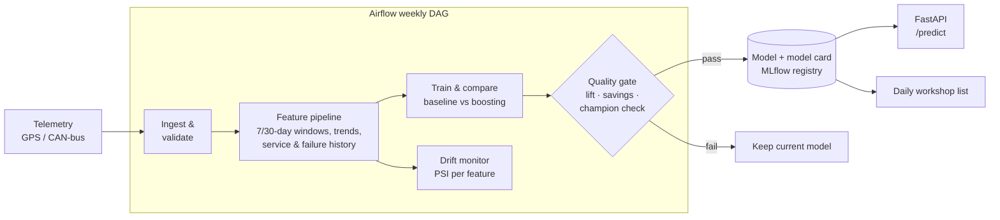

# 🔧 Fleet Predictive Maintenance

**Predict which commercial vehicles will break down in the next 14 days, and turn that into a
workshop plan that saves money.** An end-to-end MLOps project: data pipeline, experiment tracking,
a quality-gated model release, a prediction API, drift monitoring, Airflow orchestration, Docker and
Azure deployment.

> Data: synthetic daily telemetry for 400 vehicles over 12 months (146,000 vehicle-days), modelled on
> real fleet telematics (GPS/CAN-bus). Breakdowns follow a hazard model driven by wear, overdue service,
> age, harsh driving and sensor degradation, and about a third are sudden with no warning, as in real life.

---

## The business problem

A breakdown on the road costs far more than a workshop visit: towing, emergency repair, an idle vehicle,
missed deliveries and SLA penalties. Most fleets still service on fixed intervals, which inspects healthy
vehicles and misses failing ones.

**Goal:** rank the fleet every day by breakdown risk and send the right vehicles to the workshop early.

**Decision metric:** net AED saved, not accuracy. Cost assumptions are parameters so they can be
replaced with a client's real figures:

| Assumption | Value |
|---|---|
| Cost of an on-road breakdown | AED 6,500 |
| Cost of a preventive inspection | AED 600 |
| Share of breakdowns an inspection prevents | 70% |

## Results (held-out last 3 months)

| | Logistic regression | Gradient boosting |
|---|---|---|
| Validation net savings (used for model selection) | **AED 34,900** | AED 31,600 |
| Validation PR-AUC | **0.204** | 0.198 |

**Selected: logistic regression.** The simpler model won on the business metric, so it was shipped:
it is cheaper to run and easier to explain to workshop managers.

On the untouched test period with the selected model:

- **31 of 66 breakdowns flagged in advance**, from 85 inspections
- **Estimated net saving: AED 90,050 (21% of breakdown cost)** for a 400-vehicle fleet over 3 months
- PR-AUC 0.19 against a 2.3% base rate (**8.4x better than random**), ROC-AUC 0.73

These are honest numbers on purpose: roughly a third of breakdowns in the data are sudden (tyres, accident
damage, electrical) and no model can see them coming. Reproduce with `make data train`.

---

## Architecture



| Component | What it does | Where |
|---|---|---|
| Data generator | Realistic telemetry with wear, service resets and sudden vs gradual failures | `src/fleetpm/data.py` |
| Features | 36 leakage-safe features: rolling sensor windows, trends, km since service, failure history | `src/fleetpm/features.py` |
| Training | Time-based split with a 14-day gap, two models, cost-optimal threshold, MLflow logging | `src/fleetpm/train.py` |
| Business layer | Simulates the inspection policy and computes AED savings | `src/fleetpm/business.py` |
| Quality gate | Promotes only if lift ≥ 3x random, savings > 0, and not worse than the production model | `src/fleetpm/train.py` |
| Serving | FastAPI: `/predict` (with per-vehicle risk drivers), `/model-info`, `/health`, `/metrics` | `serve/api.py` |
| Batch scoring | Daily ranked workshop list | `src/fleetpm/score_fleet.py` |
| Monitoring | Population Stability Index per feature, retrain recommendation | `src/fleetpm/monitor.py` |
| Orchestration | Airflow DAG: ingest → validate → train → gate → drift → score | `dags/fleet_pm_pipeline.py` |
| Deployment | Docker, docker-compose (API + MLflow + Airflow), Azure Container Apps script, GitHub CI | `Dockerfile`, `deploy/` |

---

## Quick start

```bash
git clone https://github.com/vineethasusan/fleet-predictive-maintenance.git
cd fleet-predictive-maintenance
python -m venv .venv && source .venv/bin/activate
make install
make data        # 146k vehicle-days of telemetry
make train       # trains, compares, gates and saves the model; logs to MLflow
make score       # today's workshop priority list -> reports/workshop_list.csv
make monitor     # drift report -> reports/drift_report.json
make api         # http://localhost:8000/docs
make mlflow-ui   # compare runs at http://localhost:5000
```

**Everything in Docker** (API on :8000, MLflow on :5000, Airflow on :8080):

```bash
docker compose up --build
```

**Deploy to Azure** (Container Apps in UAE North, scales to zero): see [`deploy/azure.md`](deploy/azure.md).

```bash
az login && make deploy
```

### Example API call

```bash
curl -X POST localhost:8000/predict -H "Content-Type: application/json" -d @sample_request.json
```

```json
{
  "model_version": "20261014-121500",
  "threshold": 0.9434,
  "predictions": [
    {"vehicle_id": "DXB-1042", "risk_score": 0.9855, "risk_band": "high", "inspect_now": true,
     "top_risk_drivers": ["coolant_temp_max_7d", "coolant_temp_avg_30d", "km_since_service"]},
    {"vehicle_id": "SHJ-2210", "risk_score": 0.0315, "risk_band": "low", "inspect_now": false}
  ]
}
```

---

## Design decisions

- **Optimise money, not accuracy.** With a 2% failure rate, accuracy is meaningless. The threshold and the
  model are both chosen by simulated AED savings on a validation window.
- **No leakage.** Labels look strictly forward, features strictly backward (tested), and the train/test split
  is by time with a 14-day gap so no training label peeks into the test period.
- **No test-set tuning.** Threshold and model selection use a validation slice of the training window only.
- **Champion/challenger release.** A new model must beat random, save money, and match the production model
  before it replaces it. Rejected candidates are logged, not deployed.
- **Explainable alerts.** Each high-risk vehicle comes with its top risk drivers, so a workshop manager knows
  what to check first.
- **Monitor inputs, not just outputs.** Labels arrive weeks late, so PSI drift on features is the early
  warning (e.g. a faulty sensor batch or a new vehicle type).

## Project structure

```
fleet-predictive-maintenance/
├── src/fleetpm/
│   ├── data.py          # synthetic telemetry generator
│   ├── features.py      # features, labels, time split
│   ├── train.py         # training, selection, quality gate, MLflow
│   ├── business.py      # inspection policy and AED savings
│   ├── predictor.py     # model loading, scoring, risk drivers
│   ├── score_fleet.py   # daily batch scoring
│   └── monitor.py       # PSI drift monitoring
├── serve/api.py         # FastAPI service
├── dags/                # Airflow pipeline
├── deploy/              # Azure Container Apps script and guide
├── tests/               # leakage, business logic, training, drift, API tests
├── Dockerfile, docker-compose.yml, Makefile
└── .github/workflows/ci.yml
```

## Roadmap

- Survival model (time-to-failure) alongside the 14-day classifier
- Workshop-capacity constraint: choose the best K vehicles per day
- Load features from Databricks / Delta tables instead of CSV
- Alerting (email / Teams) when the drift monitor recommends retraining

## Author

**Vineetha Susan Alexander** · Senior Data Scientist & AI Engineer, Dubai
[LinkedIn](https://www.linkedin.com/in/vineetha-susan-alexander-465997135) · [GitHub](https://github.com/vineethasusan)

MIT License.
